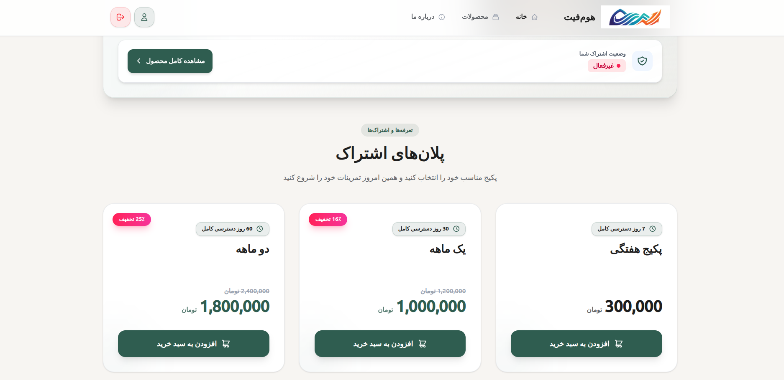
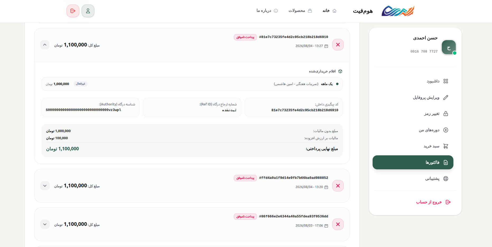
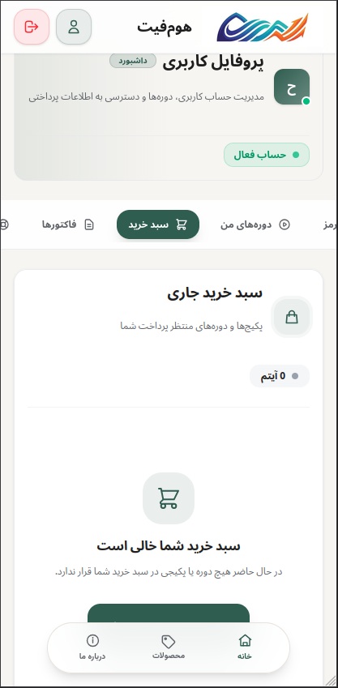

# Sports Training Subscription Platform


A **Django** web application for selling subscriptions and delivering sports training content, featuring phone-based user accounts, an AJAX-powered user panel, a shopping cart, online payments, and time-limited content access.

This project was originally commissioned by a client. Development stopped before completion when the engagement ended. The current version is presented as a **web development portfolio project**, not a finished, production-ready commercial product.

## About the Project

The business model is based on subscription access rather than permanent ownership of a course. Users purchase a subscription package, such as a one-month plan, and gain access to the associated content until their subscription expires.

The content was intended to be updated weekly, and the project structure includes workout courses and daily workouts. Subscription duration is defined at the package level, so purchasing and renewal logic is not restricted to a single fixed period.

## Screenshots

- Products: `screenshots/Products.png`  
  
  
- Subscriptions: `screenshots/Subscriptions.png`  
  

- Profile Invoices: `screenshots/Profile-Invoices.png`  
  
  
- Profile Cart: `screenshots/Profile-Cart.png`  
  

## Implemented Features

### User Accounts and Authentication

- Custom user model with a phone number as the login identifier.
- User registration, login, and logout.
- Phone number verification and account activation using a one-time password (OTP).
- OTP-based password recovery and password reset.
- Configurable OTP expiration, resend cooldown, and password reset session timeout.
- Request rate limiting for registration and password recovery.
- Phone number normalization and validation, with storage in E.164 format.
- Password recovery responses that do not disclose whether a phone number exists in the system.

### AJAX-Powered User Panel

Panel sections are loaded asynchronously using JavaScript and the Fetch API, allowing users to navigate between them without a full page reload.

- User dashboard.
- Account information viewing and editing.
- Password changes.
- Shopping cart and order viewing.
- Access to courses associated with a subscription.
- Loading indicators during AJAX requests.
- Success feedback during the password change flow.

### Training Content and Courses

- Data models for workout courses and daily workouts.
- Courses linked to subscription products.
- AJAX-based loading of workout details.
- Markdown content rendering.
- Active course configuration through `ActiveWorkoutCourseConfig`.
- Subscription status and remaining days displayed on relevant pages.
- Calculation of the number of days until the next course update.
- Slug-based URLs for products and courses.

### Products and Subscription Packages

- Subscription products and packages with defined prices and validity periods.
- Product listing and detail pages.
- User access status displayed on the product page.
- Image variants generated with ImageKit and responsive image delivery.

### Shopping Cart, Orders, and Payments

- Adding subscription packages to the shopping cart.
- Limiting the cart to one package per subscription product.
- Order creation with product titles, package titles, and prices recorded in order items.
- Orders saved before initiating payment.
- ZarinPal integration for payment initiation and verification, with sandbox configuration.
- Storage of payment request identifiers and transaction reference numbers.
- Order payment status management and payment result display.
- Subscription access activation after successful payment verification.
- Purchased items removed from the cart after the purchase flow is completed.

### Subscription and Access Management

- Per-user, per-product access validity stored in `SubscriptionEntitlement`.
- Subscription activation history recorded in `SubscriptionOrderHistory`.
- New or expired subscriptions activated starting from the current time.
- Active subscriptions extended by adding the newly purchased duration to the existing expiration date.
- Order item activation status and history checked to prevent the same purchase from being applied more than once.
- Subscription activation timestamps recorded for each order item.

### User Interface and Site Administration

- Persian templates with a right-to-left layout.
- Tailwind CSS, the Vazirmatn font, and Font Awesome.
- Mobile layout improvements for course pages, product pages, and the user panel.
- Home and About pages with a shared header and footer.
- General site information managed through `SiteSettings` and exposed to templates through a context processor.
- Django Admin used to manage users, content, products, orders, and subscriptions.

## Technology Stack

| Area | Technology / Tool |
| --- | --- |
| Backend | Python, Django |
| Frontend | Django Templates, Tailwind CSS, JavaScript |
| Asynchronous interactions | AJAX, Fetch API |
| Phone number handling | django-phonenumber-field |
| Image processing | django-imagekit |
| Training content rendering | Markdown |
| Online payments | ZarinPal |
| Number formatting | django.contrib.humanize |
| Typography and icons | Vazirmatn, Font Awesome |
| Data administration | Django Admin |

## Application Structure

| Application | Responsibility |
| --- | --- |
| `accounts` | Custom user model, authentication, OTP, and user panel |
| `workouts` | Courses, daily workouts, and active course configuration |
| `products` | Subscription products and purchasable packages |
| `orders` | Shopping cart, orders, and payment gateway integration |
| `entitlements` | User access validity and subscription activation history |
| `core` | Public pages and site settings |

Separating products, orders, and entitlements keeps subscription purchases distinct from the user's current right to access content.

## Purchase and Subscription Activation Flow

```text
Select a product and subscription package
                    ↓
                Add to cart
                    ↓
Create an order and record order item details
                    ↓
      Initiate a ZarinPal payment request
                    ↓
Return from the gateway and verify the payment
                    ↓
       Record successful payment status
                    ↓
        Create or extend user access
                    ↓
Record activation history and remove purchased items from the cart
```

### Technical Notes on the Order Service

- Order creation and subscription activation use `transaction.atomic`.
- Critical operations use `select_for_update` to lock records on database backends that support it.
- Order item display information and prices are stored when the order is created, rather than relying solely on the product's current values.
- Subscription activation checks that the order item belongs to the user and that the order has been paid.
- Order item activation status and history are checked before extending access validity.
- Payment gateway communication errors and invalid states are logged.

These measures are part of the current implementation. They do not replace payment integration testing, concurrency testing, or a security review before deployment.

## Local Development Setup

### 1. Clone the repository
```bash
git clone https://github.com/hassan-ahmadi-jo/sport.git
cd sport
```
### 2. Create Database File
```bash
touch db.sqlite3
```

### 3. Create a Virtual Environment

Run the following in the project directory:

```bash
python -m venv .venv
```

Activate it on Linux and macOS:

```bash
source .venv/bin/activate
```

Activate it in Windows PowerShell:

```powershell
.venv\Scripts\Activate.ps1
```

### 4. Install Dependencies and Review Settings

Install the project dependencies:

```bash
pip install -r requirements.txt
```
Before running the application, review the database, static and media file configuration, custom user model, and OTP settings.

### 5. Payment Configuration

The project is currently configured to use **ZarinPal’s sandbox environment** for development and testing. The following settings are defined directly in the Django settings file, using test values rather than live payment credentials:
```text
    ZARINPAL_MERCHANT_ID
    ZARINPAL_ACCESS_TOKEN
    ZARINPAL_SANDBOX
```
The payment callback URL is generated from the current request. To test the complete payment flow, make sure the application URL and callback configuration are compatible with the sandbox environment.

### 6. Prepare the Database and Run the Application

After installing dependencies and completing the configuration, run the following from the directory containing `manage.py`:

```bash
python manage.py migrate
python manage.py createsuperuser
python manage.py runserver
```

To explore the main application flow, use the admin panel to create the required initial data, including a product, a subscription package, a course, workouts, and an active course configuration.

## Project Status and Portfolio Scope

This repository reflects the state of the project when development stopped. Significant parts of authentication, the user panel, content management, purchasing, and subscriptions have been implemented, but the project is not presented as a finished commercial release.

- Weekly updates were the intended content delivery schedule; automated publishing is not among the completed features described in this README.
- The presence of payment logic does not establish readiness for live transactions. Gateway settings and the complete purchase flow must be tested in an appropriate environment.
- Before public deployment, the project requires a security review, testing of primary flows and error paths, secrets management, and complete runtime configuration.

This portfolio project focuses on **subscription-based business modeling, separation of application responsibilities, AJAX-powered user panel development, and the integration of orders, payments, and access entitlements**.
